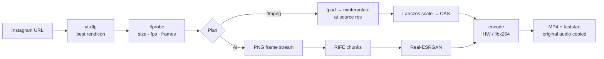

# Media Downloader — best-quality downloads + 4K 60 fps enhancement

A free, self-hostable web app that downloads **Instagram** reels/posts/stories, **YouTube**
videos and Shorts, **TikTok** videos and **DeviantArt** art and films in the highest quality each
platform actually serves, and optionally **enhances them to 4K (2160p) at 60 fps** (videos) or
upscales them to 4K (images). Paste a link anywhere on the page and it starts.

**v2 — MediaFlow.** The same downloader, grown into a small media-preparation workspace (see
[docs/product-strategy-v2.md](docs/product-strategy-v2.md)): bring in **several links and/or
your own files** at once, pick an **outcome** — *Keep original*, *Enhance* or the new
*Standardize for editing* — **review the plan** per file before anything is processed, and get
results with **treatment labels**, a **ZIP of everything** and a **manifest** (JSON/CSV with
SHA-256 checksums). The v1 flow — paste one link, it starts — is unchanged.

The default enhancement engine is **classical signal processing in ffmpeg — not AI**. An
optional, *experimental and unverified* AI engine (RIFE + Real-ESRGAN neural networks) is wired
in for people who install those binaries; see [Is any of this AI?](#is-any-of-this-ai).

## The honest part first: Instagram does not serve 4K

Every upload is re-encoded by Instagram. Its CDN tops out at **1080 × 1920, usually 30 fps**
(occasionally 60). No downloader can retrieve pixels Instagram never stored, so any tool that
"downloads 4K" is upscaling behind your back.

What this app does instead:

1. **Ranks the renditions exposed by direct extraction.** Instagram exposes several progressive MP4s plus a
   DASH manifest per video; some renditions don't even carry a resolution. Many downloaders take
   whatever appears first. We decode the CDN's `efg` rendition tag to size unsized formats, rank
   everything by resolution → frame rate → bitrate, and merge the best video and audio streams.
2. **Enhances locally, and says so.** The 4K 60 fps file is *computed* on your server:
   - frame interpolation at the source resolution (cheaper and cleaner than at 4K),
   - Lanczos upscaling (or Real-ESRGAN in AI mode),
   - a light pass of contrast-adaptive sharpening (CAS) — enough to restore perceived detail,
     gentle enough to avoid the halos and "oil-painting" look that make upscales feel artificial.
3. **Shows you both files.** The original best rendition is always offered alongside the
   enhanced one, with real dimensions, frame rate and bitrate read back from the output.

## Features

- Paste-to-go: a link pasted anywhere on the page (even inside share-sheet text) starts the job
- **Instagram**: reels, posts (incl. carousels), IGTV, stories, highlights, `/share/` links
- **YouTube**: videos, Shorts, `youtu.be` links (single videos only; playlists are ignored)
- **TikTok**: videos incl. `vm.tiktok.com` short links
- **DeviantArt**: original image files and the highest film rendition (custom extractor —
  yt-dlp has none)
- Best-rendition selection (yt-dlp with a custom format selector)
- **Upload & convert**: upload a local video and download an MP4 in HD, Full HD, QHD or
  4K, with presets up to **4K at 60 fps**; no platform link or login required
- Enhancement presets: resolution *original / 1440p / 4K*, frame rate *original / 60*
- Engines: **ffmpeg** (`minterpolate` + Lanczos + CAS) by default; **AI** (`rife-ncnn-vulkan` +
  `realesrgan-ncnn-vulkan`, or `video2x`) if you install the binaries — experimental
- Hardware encoding auto-detected (VideoToolbox / NVENC / QSV), libx264 fallback
- Logins without copying cookies: on your own machine the app reuses your browser's Instagram
  session automatically when Instagram demands one; servers can hold a session in env vars;
  users can still paste a cookie
- Progress reporting, cancellation, per-IP limits, automatic file expiry
- No database, no build step: FastAPI + vanilla JS

### MediaFlow workspace (v2)

- **Batches**: queue up to `MAX_ITEMS_PER_JOB` links and files and process them as one job. With
  something already in the batch, pasted links join it instead of starting a job, and pasting
  several links at once adds them all. One failing link doesn't sink the rest.
- **Your own files**: drag and drop (or browse/paste) MP4, MOV, MKV, WebM, AVI, PNG, JPG, WebP
  or GIF. Each file is checked with ffprobe on upload and capped at `MAX_UPLOAD_MB`.
- **Standardize for editing**: one frame size (1080p/720p/4K landscape, vertical, square or the
  clip's own), *fit* (black bars) or *fill* (crop), a constant 24/25/30/60 fps (or the
  source rate made constant), H.264 + AAC 48 kHz, square pixels and fast-start. Images become a
  PNG on the same canvas. Frame-rate changes repeat or drop frames; they never invent motion.
- **Review before processing** (on by default for batches): the job fetches and probes
  everything, then pauses and shows *source → target* for each file with treatment badges and
  warnings (e.g. "upscaling makes the frame bigger, not sharper"). Change the outcome and the
  plan updates; nothing is processed until you press **Process**.
- **Honest labels**: every output carries treatments — *Native*, *Your file*, *Upscaled*,
  *Interpolated*, *AI upscaled*, *Letterboxed*, *Cropped*, *Frame rate converted*,
  *Constant frame rate*, … — in the UI, the manifest and the ZIP.
- **Bundle**: *Download all (.zip)* plus `manifest.json` / `manifest.csv` with dimensions,
  frame rate, duration, codec, engine, treatments and SHA-256 for each file.
- **Product metrics** (`/api/metrics`): aggregate counts only — successful sessions (the north
  star), time to first output, outcome mix, review approvals. No URLs, IPs or file names.

## Platform notes

| Platform | Native ceiling | Anonymous access | Notes |
|---|---|---|---|
| Instagram | 1080p, usually 30 fps | mostly login-walled | see [Logins](#logins-stories-private-accounts--and-most-reels) |
| YouTube | up to 4K/8K | yes from home/office IPs; **cloud IPs get "confirm you're not a bot"** (the app retries with the TV client, then needs `YOUTUBE_COOKIES` or `PROXY_URL`) | needs a JS runtime (Node ≥ 22 or Deno) for all formats; clips longer than `MAX_SOURCE_DURATION_SECONDS` are refused |
| TikTok | 1080p, 30 fps (some 60) | yes from home IPs; **cloud IP ranges are blocked outright** (`PROXY_URL` only) | also geo-blocked in some countries (e.g. India) — the server's network matters, not yours |
| DeviantArt | original image / 1080p film | yes for public deviations | mature content needs an `auth` cookie; images are upscaled (Lanczos + CAS) in Enhance mode |

## Quick start

Requirements: Python 3.11+, ffmpeg 5+ (`brew install ffmpeg` / `apt install ffmpeg`).

```bash
python3 -m venv .venv && source .venv/bin/activate
pip install -r requirements.txt
uvicorn app.main:app --host 127.0.0.1 --port 8000
```

Open <http://127.0.0.1:8000>, paste a link, pick **Enhance → 4K 60 fps** or **Original**.

The website defaults to **Original · fastest**: paste a supported public link, wait for the
download card, and save the file. Enhancement is optional and takes longer; an explicitly
selected preference is remembered in that browser. No app login is required unless an
operator explicitly configures `APP_USERNAME` and `APP_PASSWORD`.
After fetching an original video, click **Upscale to 4K 60 fps** on its result card.
The app converts the already-downloaded file without contacting the source site again,
then shows a separate **Download 4K 60 fps** button alongside the original.
The original stays available if conversion is cancelled or fails.

For an open public instance, leave both app credentials unset and set
`AUTO_BROWSER_COOKIES=off`. Do not configure your personal site cookies on a public server.
Anonymous access depends on the source platform and the individual post: a public link can
still be restricted or rate-limited by Instagram. The app reports this rather than pretending
that every link can be downloaded without a site login. Upload & convert remains available
for videos you already have.

### Optional FastVideoSave fallback

Set `FASTVIDEOSAVE_ENABLED=1` to retrieve public Instagram photos, video posts, carousels
and active stories through FastVideoSave's public website. Reels/IGTV still try direct
extraction first, then use this provider if needed. Install its browser with
`python -m playwright install chromium` (already included in the Docker image), or set
`FASTVIDEOSAVE_BROWSER_CHANNEL=chrome` to use an installed Chrome.

The app keeps its own UI: the server opens a fresh, temporary browser context, submits
only the normalized public Instagram URL, and downloads the returned MP4/JPEG/PNG/WebP files directly from
Instagram's CDN. No personal browser profile, Instagram cookies, Apify token or HikerAPI
token is shared. The UI discloses this handoff and labels provider results. Anonymous
`/p/` posts use the provider first so photo and mixed-carousel items are not silently
dropped by the video-only direct extractor. If it fails, direct extraction is attempted,
with an explicit warning that photos may be missing. Authenticated requests and highlights
stay on the existing direct path; no personal cookies are sent to this provider.

Paste `https://www.instagram.com/stories/username/` for available active stories, or a
specific `https://www.instagram.com/stories/username/story-id/` link. Plain usernames and
profile-page URLs are not story inputs. Private, expired and unavailable stories may fail.
This is not access to an account's story archive. The provider may return fewer items
than Instagram shows; availability is not guaranteed.

Instagram now serves many reels as separate video and audio streams, and FastVideoSave
returns only the video. When a single provider video has no audio track, the server asks
SnapSave's public page for the same link (same temporary, ad-blocked browser; public URL
only) and copies its audio track onto the video without re-encoding, after checking the
lengths match. If that fails the silent video is kept and the job shows a warning. Set
`SNAPSAVE_AUDIO_ENABLED=0` to turn this off.

FastVideoSave moves the API host its page calls (e.g. `api.videodropper.app` →
`api.getrequest.dev`); the server's browser only talks to allow-listed hosts, so such a
move makes every request time out. `python -m app.fastvideosave_probe` checks the provider
and, if it broke, finds the host now returning Instagram media, verifies it, and saves it
to `DATA_DIR/fastvideosave-hosts.json`, which the app re-reads per request (no restart).
Run it periodically: `deploy/macos/install-fastvideosave-probe.sh` installs an hourly
launchd job; on Linux use cron or a systemd timer. Its latest report is served at
`GET /api/providers/fastvideosave`. The scheduled GitHub workflow
`.github/workflows/fastvideosave-health.yml` runs every 6 hours, opens a PR updating the
bundled `app/fastvideosave_hosts.json` when the host moves, and opens an issue when the
provider is down. FastVideoSave's Cloudflare challenges GitHub's runners, so set the
repository secret `MEDIAFLOW_URL` to your deployment's public URL (plus
`MEDIAFLOW_USERNAME`/`MEDIAFLOW_PASSWORD` if sign-in is on); the workflow then uses that
server's hourly probe report. Without it the runner probes itself, and a Cloudflare
challenge is only a warning. `FASTVIDEOSAVE_PROBE_URLS` (comma-separated) overrides the
public posts it tests with.

**Faster downloads behind Tailscale Funnel.** Funnel traffic is relayed and can be capped
around 0.1–0.2 MB/s, far below the host's uplink. `deploy/macos/install-download-tunnel.sh`
runs a free cloudflared quick tunnel under launchd and sets `DOWNLOAD_TUNNEL_METRICS` in
`.env` (restart the app afterwards). The UI stays on the stable Funnel hostname; finished
files and zip archives requested through it are redirected (HTTP 307) to the tunnel's
current `*.trycloudflare.com` hostname, which the app reads from cloudflared's metrics
server and checks before use. If the tunnel is down, files are served directly as before.
Requests to IP/localhost hosts are never redirected, and the redirect is off when app
sign-in is enabled (credentials don't carry across hostnames). Uploads stay on Funnel, which
has no 100 MB request-body limit.

For a permanent address on a domain in your (free) Cloudflare account, run
`deploy/macos/install-named-tunnel.sh media.example.com` instead. It logs in to Cloudflare
(once, in the browser), creates a named tunnel `mediaflow`, points the DNS record at it,
replaces the quick-tunnel launchd job and sets `DOWNLOAD_TUNNEL_HOSTNAME`; restart the app.
That hostname also serves the whole app directly (uploads there are limited to 100 MB).

Each photo has **Download photo** and **Upscale image to 4K** controls. Upscaling reuses
the downloaded image, preserves the original, and produces a PNG bounded by 3840x2160
(2160x3840 portrait; 2160x2160 square), preserving aspect ratio without cropping.
Larger sources are not reduced. Photos have no frame rate: 60 fps applies only to videos.
This uses classical Lanczos scaling/sharpening, not AI.

Videos expose whether the retrieved file contains an audio track. If it does not, a
warning explains that the original Instagram post may still have sound. Re-fetching
can help when the provider later supplies a complete version, but cannot be guaranteed.
Audio supplied by the provider is retained during download and preserved during conversion;
upscaling cannot recreate missing audio.

This is an **unofficial, optional integration**, not a supported API or an affiliation.
Review the provider's terms and obtain any permission needed for your deployment. The
provider sees submitted URLs and the server IP; its availability, limits, browser
checks and page structure can change. Challenges are not bypassed. There is no guarantee
of access or of the highest source rendition. Photo download links and video sources are
collected in page order and deduplicated; video preview thumbnails are not treated as photos.
Existing 4K60 conversion works on the retrieved MP4s.

Metadata retrieval is bounded to roughly one minute per attempt. Transient browser
connection errors, navigation timeouts and browser crashes get one retry in a fresh
browser context (at most two attempts). Missing browser installations or system
dependencies are reported separately; provider rejections and unsupported media are
not retried. Runtime errors no longer instruct users to install Chromium when it is
already running. Logs record failure categories, not raw errors with signed media URLs.
Downloads share `MAX_UPLOAD_MB`
as an aggregate size cap and are subject to `MAX_SOURCE_DURATION_SECONDS` after probing.
Only HTTPS Instagram/Facebook CDN media addresses and redirects are accepted. Browser
requests are limited to the provider and its browser-check host; ads are blocked.
Disabling `FASTVIDEOSAVE_ENABLED` restores the direct-only path.

Image conversion API: `POST /api/jobs/{id}/files/{index}/upscale?resolution=2160p`
(`1440p` is also accepted). It uses the normal job status/download/cancellation endpoints,
per-IP concurrency limit, enhancement enablement and file expiry. An independent hard link
keeps the source alive if the original job expires during conversion. Uploaded-video
conversion remains unchanged; this image endpoint operates on already-downloaded images.

### Convert a video from your device

Use **Upload & convert**, choose a video and an output quality, then click **Upload & convert**.
The app shows upload progress followed by conversion progress, with cancellation and a
**Download MP4** button when ready. Supported self-contained containers include MP4/MOV/M4V,
MKV/WebM, AVI, MPEG/TS, FLV, Ogg and WMV/ASF, with codecs your server's ffmpeg can decode.
Still images, audio-only files, playlists and corrupt or unsupported videos are rejected.

Presets: **720p 30 fps**, **1080p 30 fps**, **1080p 60 fps**, **1440p 60 fps**,
**4K 30 fps**, and **4K 60 fps**. Unlike link enhancement (which never reduces a source),
conversion targets the selected resolution and exact frame rate, including downscaling or
reducing higher-rate inputs. Aspect ratio and portrait orientation are preserved without
cropping or stretching: a 16:9 4K output is 3840×2160, portrait is 2160×3840, and other aspect
ratios fit within these bounds. MP4 uses the configured video encoder; compatible audio is
copied, otherwise converted to AAC. Matching-resolution sources are still converted to MP4.

This section uses **ffmpeg only, not AI**, even if optional AI binaries are installed.
Lanczos scaling and motion-compensated interpolation cannot recover missing source detail.
AI enhancement for uploaded videos is left for a future version.

Videos are uploaded to the server, not processed in your browser. The default upload limit is
**500 MiB** (`MAX_UPLOAD_MB`) and duration limit is **10 minutes** (`MAX_DURATION_SECONDS`).
Upload and conversion jobs share the existing per-IP/concurrency limits. Source uploads are
removed after processing; converted files expire after `JOB_TTL_MINUTES`. Aborted uploads
and failed conversions are cleaned up. Configure reverse-proxy body limits and timeouts to
allow large uploads. `ENHANCEMENT_ENABLED=false` disables this section too.

### Docker

```bash
docker compose up --build
# or
docker build -t reel-downloader . && docker run -p 8000:8000 -v reel-data:/data reel-downloader
```

Instagram changes often; if downloads start failing, rebuild the image / `pip install -U yt-dlp`.

### Render (free tier, downloads only)

[`render.yaml`](render.yaml) is a Render Blueprint. In the Render dashboard: **New → Blueprint**,
connect this GitHub repository, pick the branch, deploy. The free instance (0.1 CPU / 512 MB)
is fine for downloading but far too small for 4K60 enhancement, so the blueprint sets
`ENHANCEMENT_ENABLED=false` — the UI then hides the Enhance option. Add
`INSTAGRAM_COOKIES` (a throwaway account's `sessionid=…; ds_user_id=…; csrftoken=…`) as an
environment variable in the dashboard, because Instagram login-walls datacenter IPs. Free
services spin down after 15 idle minutes; the first request afterwards takes ~1 minute.

### Hugging Face Spaces (Docker; PRO subscription required for the CPU tier)

The README front matter declares `sdk: docker` / `app_port: 8000`, so the repo can be pushed to
a Docker Space as-is (`huggingface-cli repo create <name> --type space --space_sdk docker`, then
`git push hf main`). Set the same variables as above via Settings → Variables and put
`INSTAGRAM_COOKIES` in Secrets. Enhancement on 2 vCPU is slow: use `X264_PRESET=veryfast`,
`FFMPEG_INTERP_QUALITY=fast`, `MAX_DURATION_SECONDS=120`.

### A real server — Oracle Cloud Always Free or any VPS (full 4K60)

See [`deploy/oracle/README.md`](deploy/oracle/README.md): one command installs Docker, opens the
firewall, and starts the app behind Caddy with automatic HTTPS (free `*.sslip.io` hostname or
your own domain). Oracle's Always Free ARM VM (4 cores / 24 GB) runs enhancement at roughly
real time.

## Logins: stories, private accounts — and most reels

### Protecting a personal public instance

Set both `APP_USERNAME` and a long random `APP_PASSWORD` to require a browser sign-in
(HTTP Basic authentication) for **every page, API route, upload, preview and download**.
Use HTTPS for remote access; credentials are not encrypted by Basic authentication itself.
Setting only one variable fails startup instead of silently leaving the app public.
Keep credentials out of Git. API clients and health checks must supply the same Basic auth.

For a password-protected instance on your own Mac, `AUTO_BROWSER_COOKIES=always` and
`BROWSER_COOKIE_ORDER=chrome` allow Instagram downloads to reuse your Chrome login even
through a public tunnel. **Every person with the app password can use your Instagram
session**, including for content your account can access. This is for personal use, not
an open public downloader. Browser-session discovery is restricted to Instagram; it
does not automatically reuse your logins for other platforms. Browser cookies stay in
memory, and the browser must already be logged in on the server machine.

Restart after changing authentication settings and reload the page. Browsers cache Basic
credentials; close a private browsing window to end its login, or rotate the server password.
The app blocks cross-origin writes and framing when authentication is enabled.

### Instagram credentials

Instagram now login-walls almost everything for anonymous visitors (the API replies "not
granting access", GraphQL returns empty, even the embed page is a login shell). Stories always
need a login; ordinary reels usually do too unless Meta has whitelisted the account. The app
therefore tries anonymously first and, when Instagram insists, uses the first credential it can
find:

| Priority | Source | Friction |
|---|---|---|
| 1 | Cookie pasted in the UI (**Advanced** panel) — a bare `sessionid`, a full `Cookie:` header, or a `cookies.txt` export | end user pastes once (optionally remembered in *their* browser) |
| 2 | `IG_SESSIONID` / `IG_COOKIES` / `IG_COOKIES_FILE` / `IG_COOKIES_FROM_BROWSER` on the server | zero — set once by the operator |
| 3 | **Automatic browser login** (`AUTO_BROWSER_COOKIES=local`, the default): for requests coming from the same machine as the server, the Instagram session of a locally installed browser is read via yt-dlp | zero — just be logged in to instagram.com in your browser |

How the automatic browser login behaves:

- Only the browser's **default profile** is read (`BROWSER_COOKIE_ORDER=safari,chrome,firefox,…`).
  Name a profile to use another one, e.g. `BROWSER_COOKIE_ORDER="chrome:Profile 3,chrome"` —
  the app never scans every profile, because on a shared computer that could pick up someone
  else's account.
- macOS: Safari's cookie file is only readable if the terminal has **Full Disk Access**; Chrome
  and Brave trigger a one-time Keychain prompt ("Chrome Safe Storage" → *Always Allow*). The
  first lookup can take ~20 s while Chrome's cookie store is decrypted; results are cached.
- Requests that arrive through a proxy (`X-Forwarded-For` present) are never treated as local,
  so remote users cannot borrow the operator's login. `AUTO_BROWSER_COOKIES=always` disables that
  protection — only for a single-user box. `off` disables the feature.
- When nothing is found, the error says exactly what was checked, e.g. *"Chrome: not logged in
  to Instagram; Safari: no permission to read its cookies"*.
- After Instagram refuses an anonymous request once, the app goes straight to the browser login
  for the next 15 minutes instead of retrying anonymously on every job.
- Settings can live in a `.env` file next to the app (see `.env.example`); real environment
  variables take precedence.

The status card shows which login was used (*anonymous*, *your Chrome login*, …). Pasted and
discovered cookies live in an in-memory cookie jar for that job only and are never written to
disk or logs. Use a throwaway account on a public server: Instagram may challenge accounts that
fetch a lot.

## Is any of this AI?

Out of the box: **no**. The default engine is deterministic signal processing inside ffmpeg:

| Step | What it actually is |
|---|---|
| Frame interpolation (`minterpolate`) | block-matching motion estimation + motion-compensated blending — codec-style math, no learned model |
| Upscaling (`scale=…:flags=lanczos`) | a fixed resampling kernel |
| Sharpening (`cas`) | AMD's contrast-adaptive sharpening formula |

It yields a smooth, natural 4K60 rendition but cannot invent detail that was never in the
1080p source. Best-rendition selection, error handling and cookie discovery are plain
heuristics too.

The **AI engine** does use neural networks — RIFE (learned optical-flow interpolation) and
Real-ESRGAN (GAN super-resolution that reconstructs plausible texture) — but only when you
install their binaries. It is **experimental and unverified**: the pipeline has been exercised
against stub programs that reproduce the documented CLI behaviour of `rife-ncnn-vulkan` and
`realesrgan-ncnn-vulkan`, not against the real models on real hardware. Expect to tune models,
tile sizes and GPU settings yourself.

## AI mode (optional, experimental)

Install any of the following and the *Auto* engine will use them:

- [`rife-ncnn-vulkan`](https://github.com/nihui/rife-ncnn-vulkan/releases) — frame interpolation
- [`realesrgan-ncnn-vulkan`](https://github.com/xinntao/Real-ESRGAN/releases) — super-resolution
- [`video2x`](https://github.com/k4yt3x/video2x/releases) — wraps both; used when the two above are missing

Put the binaries (with their `models/` folders) on `PATH`, or point `RIFE_BIN` /
`REALESRGAN_BIN` / `VIDEO2X_BIN` at them. They run on any Vulkan-capable GPU (including Apple
Silicon via MoltenVK); CPU-only machines should stay on the ffmpeg engine.

The ncnn pipeline streams frames: ffmpeg decodes once → chunks of `AI_CHUNK_FRAMES` (with the
overlap RIFE needs) → RIFE → Real-ESRGAN → straight into a single encoder process. Disk usage is
bounded by one chunk, whatever the clip length. Expect roughly 1–5 fps of output at 4K on a
mid-range GPU, i.e. several minutes per reel.

## How enhancement works



Details worth knowing:

- **Targets**: "4K" means the short side reaches 2160 px with the long side capped at 3840
  (1080×1920 → 2160×3840, 1080×1350 → 2160×2700, landscape → 3840×2160).
- **Frame rate**: the multiplier is a small rational so frames land on an exact grid:
  30 → 60 (×2), 25 → 60 (×12/5), 24 → 60 (×5/2). NTSC sources snap to ×2 (29.97 → 59.94) to
  avoid audio drift.
- **Tail fix**: `minterpolate` silently drops the last ~1.5 source frames; we clone the final
  frame before interpolating and trim afterwards, so the enhanced clip has the same length.
- **Encoding**: libx264 CRF 18 by default; hardware encoders get a bitrate derived from
  `BITS_PER_PIXEL` (≈ 40 Mbps for 4K60). Audio is copied untouched.

## Configuration

All settings are environment variables — see [`.env.example`](.env.example) for the full,
commented list. The important ones:

| Variable | Default | Purpose |
|---|---|---|
| `DATA_DIR` | `./data` | where job files live |
| `JOB_TTL_MINUTES` | `60` | files are deleted this long after a job finishes |
| `MAX_CONCURRENT_JOBS` | `2` | parallel jobs (enhancement is CPU/GPU heavy) |
| `MAX_JOBS_PER_IP` | `2` | active jobs per client |
| `ENHANCEMENT_ENABLED` | `true` | `false` turns the app into a plain best-quality downloader (weak servers) |
| `MAX_DURATION_SECONDS` | `600` | longest clip that will be *enhanced* |
| `MAX_UPLOAD_MB` | `500` | largest uploaded video in MiB; conversion also uses `MAX_DURATION_SECONDS` |
| `VIDEO_ENCODER` | `auto` | `libx264`, `libx265`, `h264_videotoolbox`, `h264_nvenc`, … |
| `X264_PRESET` / `X264_CRF` | `medium` / `18` | software-encoder quality |
| `SHARPEN` | `0.3` | CAS strength after upscaling, `0` disables |
| `FFMPEG_INTERP_QUALITY` | `high` | `fast` is ~2× quicker with slightly more ghosting |
| `INSTAGRAM_COOKIES`, `YOUTUBE_COOKIES`, `TIKTOK_COOKIES`, `DEVIANTART_COOKIES` | — | `Cookie:` header strings configured on the server (`IG_SESSIONID`/`IG_COOKIES` still work) |
| `COOKIES_FILE` / `COOKIES_FROM_BROWSER` | — | shared cookies.txt, or a local browser to read from |
| `PROXY_URL`, `<PLATFORM>_PROXY` | — | outbound proxy for yt-dlp (residential proxies get around YouTube/TikTok cloud-IP blocks) |
| `MAX_SOURCE_DURATION_SECONDS` | `1800` | refuse to *download* longer videos (YouTube) |
| `AUTO_BROWSER_COOKIES` | `local` | reuse a local browser's Instagram login for same-machine requests (`always`, `off`) |
| `BROWSER_COOKIE_ORDER` | `safari,chrome,…` | browsers/profiles to check, yt-dlp `BROWSER[:PROFILE]` syntax |
| `AI_ENGINE` | `auto` | `ncnn`, `video2x`, or `off` |
| `AI_UPSCALE_MODEL` | `realesrgan-x4plus` | `realesr-animevideov3` is much faster |
| `AI_CHUNK_FRAMES` | `32` | frames per AI batch (disk vs. model-reload trade-off) |
| `MAX_ITEMS_PER_JOB` | `10` | links + files per batch |
| `UPLOADS_ENABLED` | `true` | `false` hides the drop zone and rejects `POST /api/uploads` |
| `MAX_UPLOAD_MB` | `500` | largest accepted upload |
| `MAX_UPLOADS_PER_IP` | `20` | uploaded files waiting to be used per client (unused ones expire with `JOB_TTL_MINUTES`) |
| `METRICS_ENABLED` | `true` | `false` turns off `/api/metrics` and in-memory counting |

## API

| Method | Path | Notes |
|---|---|---|
| `GET` | `/api/capabilities` | encoder, AI availability, auth status (incl. whether browser login applies to you), limits, outcomes, standardize presets, upload limits |
| `POST` | `/api/uploads?filename=…` | raw file as the request body → `201 {"id", "filename", "size", "info"}` (`413` too large, `400` not media, `403` disabled) |
| `DELETE` | `/api/uploads/{id}` | discard an upload that hasn't been used |
| `POST` | `/api/convert?filename=video.mov&preset=2160p60` | raw video body (`application/octet-stream`, **not multipart**) → `202` conversion job; presets listed in `/api/capabilities`. `POST /api/uploads?…&preset=…` still works for older clients |
| `POST` | `/api/jobs` | `{"url"?, "urls"?: [...], "uploads"?: [ids], "mode": "enhance"\|"original"\|"standardize", "resolution": "2160p"\|"1440p"\|"original", "fps": "60"\|"original", "engine": "auto"\|"ffmpeg"\|"ai", "standardize"?: {"canvas": "1920x1080"\|…\|"source", "fps": "30"\|…\|"source", "fit": "pad"\|"crop"}, "review"?: false, "cookies"?}` → `202` job. The v1 body (`{"url", …}`) still works unchanged |
| `GET` | `/api/jobs/{id}` | status (`queued`, `downloading`, `review`, `enhancing`, `done`, `error`, `cancelled`), stage, progress, inputs, sources, proposals, plan, outputs (with `treatments`), warnings, failures |
| `POST` | `/api/jobs/{id}/plan` | while in `review`: proposals for different options, without changing the job |
| `POST` | `/api/jobs/{id}/start` | while in `review`: optionally new options, then process → `202` (`409` if not in review) |
| `DELETE` | `/api/jobs/{id}` | cancel a running (or waiting) job or delete a finished one |
| `GET` | `/api/jobs/{id}/files/{index}?inline=1` | download (or stream) an output |
| `POST` | `/api/jobs/{id}/files/{index}/convert?preset=2160p60` | convert an existing video output without downloading it again → `202` job |
| `POST` | `/api/jobs/{id}/files/{index}/upscale?resolution=2160p` | upscale an existing photo output to a PNG → `202` job |
| `GET` | `/api/jobs/{id}/archive` | ZIP of all outputs + manifest (`409` until done) |
| `GET` | `/api/jobs/{id}/manifest?format=json\|csv` | per-file dimensions, fps, codec, engine, treatments, SHA-256 |
| `GET` | `/api/metrics` | aggregate, anonymous product metrics (`404` when `METRICS_ENABLED=false`) |

Interactive docs at `/api/docs`.

Upload example: `curl --data-binary @video.mov -H 'Content-Type: application/octet-stream' 'http://127.0.0.1:8000/api/uploads?filename=video.mov&preset=2160p60'`.
Poll the returned job ID and use its output URL for download. Upload requests return `413`
when too large, `429` at the per-IP limit, and `400` for empty uploads or disabled conversion.
Video inspection and conversion errors appear in the job's `error` field.

## Performance expectations

Measured on an Apple-silicon laptop with the ffmpeg engine and VideoToolbox: a 5 s, 720p30
reel → 2160×3840 @ 60 fps in ~23 s (≈ 4.5× real time). A 60 s 1080p30 reel takes a few minutes;
software-only x264 on a small VPS can take 10–20 minutes. Free hosting tiers have weak CPUs,
tiny disks and datacenter IPs that Instagram tends to block — this runs best on your own
machine or a modest VPS.

## Development

```bash
pip install -r requirements-dev.txt
pytest            # unit tests + real-ffmpeg pipeline tests on a synthetic clip
ruff check . && ruff format .
```

The AI pipeline is exercised with stub binaries that reproduce the documented CLI semantics of
`rife-ncnn-vulkan` and `realesrgan-ncnn-vulkan`; the AI and video2x engines remain unverified
until someone runs them against the real binaries on real hardware.

## Limitations

- Instagram photo posts / photo stories are skipped (yt-dlp only yields videos there);
  DeviantArt images are supported.
- Instagram rate-limits and login-walls anonymous traffic, especially from cloud IPs; a login
  (browser session or pasted cookie) fixes most "empty media response" errors.
- The automatic browser login needs a browser on the *server's* machine, so it only helps when
  you run the app locally.
- Upscaling cannot invent true detail — the result is a clean, natural-looking 4K60 rendition of
  a 1080p30 source, not the creator's camera original.

## Legal

Download only content you own or have permission to use, and respect Instagram's Terms of
Service. This project is intended for personal use and is not affiliated with Instagram/Meta.
