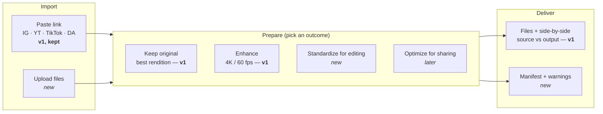

# Product Strategy — v2 ("MediaFlow" working name)

> **Status:** **decided.** v2 = the Universal Media Workspace (MediaFlow). A consumer media
> utility is a planned *future* horizon (§10.1), not part of v2. The Phase 2 product surface is
> now **built (app v2.0.0)** — see §14 for what shipped and what is still open.
> **Ground rule:** multi-platform downloading and enhancement are **kept as-is and treated as
> core assets**. v2 builds *on top of* them; it does not replace, narrow or deprecate them.
>
> Every claim below is labelled as one of: **[Fact]** (true of the code today),
> **[Hypothesis]** (needs validation), or **[Decision]** (a deliberate product choice).

---

## 1. Where we are today (v1 — Media Downloader 4K60)

| Capability | What exists **[Fact]** | Where |
|---|---|---|
| Multi-platform acquisition | Instagram (reels, posts, carousels, stories, highlights), YouTube (videos, Shorts), TikTok, DeviantArt (images + films) | `app/extractor.py`, `app/deviantart.py`, `app/urls.py` |
| Best-rendition selection | Ranks formats by resolution → fps → bitrate; decodes Instagram `efg` tags for unsized renditions | `app/extractor.py` |
| Enhancement | ffmpeg engine (minterpolate + Lanczos + CAS) by default; experimental AI engine (RIFE + Real-ESRGAN / video2x); image upscaling | `app/enhance_ffmpeg.py`, `app/enhance_ai.py`, `app/plan.py` |
| Presets | Resolution *original / 1440p / 4K*, fps *original / 60*, engine *auto / ffmpeg / ai* | `app/plan.py`, `static/app.js` |
| Honest output reporting | Original + enhanced files offered side by side with real dimensions / fps / bitrate | `app/jobs.py`, `app/media.py` |
| Logins | Pasted cookie, server env cookies, automatic local-browser login | `app/cookies.py` |
| Job control | Progress, cancellation, per-IP limits, TTL expiry, no database | `app/jobs.py`, `app/config.py` |
| Deployment | Docker, Render (download-only), HF Spaces, Oracle/VPS kit | `Dockerfile`, `render.yaml`, `deploy/` |

**Not present today [Fact]:** uploading local files, batch/multi-file jobs, format conversion
independent of a source URL, metadata/manifest export, frame extraction, saved presets,
usage instrumentation.

### Strategic diagnosis

1. **We compete on features, not on an outcome.** "Downloads from more platforms" is a crowded
   category. On its own it doesn't give anyone a reason to switch.
2. **Too many jobs share one screen.** Someone saving a reel, a creator preparing footage and a
   researcher collecting references want different things.
3. **The most interesting asset is the pipeline, not only the downloader:** *source → best
   rendition → honest enhancement → verified output*. That pipeline makes media **ready for its
   next use**.

---

## 2. Strategic choice

Three directions were considered:

| Criterion | A. Media Quality Studio | **B. Universal Media Workspace** | C. Media Prep for AI/Data |
|---|---|---|---|
| Consumer appeal | High | Medium–high | Low–medium |
| Differentiation potential | Medium | Medium–high | High (in a niche) |
| Fit with v1 code | High | **Very high** | Medium |
| MVP complexity | Low–medium | Medium | Medium |
| Business model | Freemium | Freemium / paid tiers | Paid dev tool / API |
| Main risk | Crowded category | Feature sprawl | Niche too small |

**[Decision — locked] Pursue Direction B (Universal Media Workspace, "MediaFlow"), borrowing
one workflow from Direction C (structured metadata/manifest output).**

**[Decision] Direction A is deferred, not rejected.** We'll come back to it later as a
consumer media utility built on the same pipeline (see §10.1). Direction C stays a source of
individual workflows, not a separate product.

Why B fits this repo in particular. Unlike most "workspace" tools, **we already have a
dependable link-import layer across four platforms *and* a transparent enhancement engine.**
These aren't legacy features to drop. They're the reasons someone would pick this workspace over
a generic converter:

- **Downloading is the front door.** A pasted link is still the fastest way to get media in.
- **Enhancement is one *outcome*.** It sits alongside "standardize", "optimize for sharing" and
  "prepare for editing", and it's still a first-class option.
- **Honesty is the moat [Hypothesis].** Every output says whether it is the native source
  rendition, resized, sharpened, interpolated or AI-generated. Few competitors do this.

### Positioning statement (draft)

> **For** people who regularly pull media from several platforms and their own devices,
> **who** waste time chaining downloaders, converters and upscalers,
> **MediaFlow** is a media-preparation workspace
> **that** turns any permitted link or file into output that's ready for its next use, best
> source quality first and enhancement when you want it, with an honest report of what changed.
> **Unlike** single-purpose downloaders or heavyweight editors, it is outcome-first and
> transparent about quality.

---

## 3. Product model: Import → Prepare → Deliver

**[Decision] Users pick an outcome, not FFmpeg parameters.** Advanced controls (resolution,
fps, engine) stay available behind an *Advanced* toggle, just as they work in v1.

---

## 4. What stays, what's added, what's excluded

### Kept unchanged (non-negotiable) [Decision]
- All four platform integrations and their login strategies.
- Best-rendition selection logic.
- ffmpeg and AI enhancement engines, presets, and image upscaling.
- Side-by-side original + enhanced outputs with read-back properties.
- Existing API (`/api/jobs`, `/api/capabilities`, …). New capabilities are **additive**:
  new fields or endpoints, never breaking changes.
- `ENHANCEMENT_ENABLED=false` download-only deployments keep working.

### Added in the v2 MVP
1. **Outcome picker** on top of existing presets: *Keep original*, *Enhance*,
   *Standardize for editing*.
2. **Local file upload** as a second import path into the same pipeline.
3. **Multi-item jobs** (a few links and/or files at once), processed with the existing
   concurrency limits.
4. **Standardize for editing:** normalize container/codec, resolution and frame rate across a
   set of clips (reuses `plan.py` targets and the ffmpeg encode path).
5. **Review step:** show source properties next to the proposed output before processing.
6. **Results + manifest:** per-file properties, the treatment applied (native / resized /
   interpolated / AI), warnings, timings and sizes, exportable as JSON/CSV.
7. **Basic instrumentation** for the metrics in §7 (privacy-preserving, no PII, opt-out).

### Explicitly excluded from v2 [Decision]
User accounts and collaboration · preset marketplace · cloud-storage integrations · full asset
management · subscriptions/billing · new AI models · chasing extra platforms *before* the
existing four are reliable.

---

## 5. MVP user journey

> *A user has several inconsistent clips (some from links, some on disk) and needs them ready
> for an editing timeline.*

1. **Add media:** paste links (as in v1) and/or drop files.
2. **Choose an outcome:** e.g. *Standardize for editing* (or *Enhance*, as in v1).
3. **Review:** a table of source vs. proposed output (resolution, fps, codec, est. time/size),
   with warnings such as "upscaling a 720p source to 4K won't add real detail".
4. **Process:** per-item progress and cancel (existing job engine).
5. **Inspect:** outputs with real read-back properties and a treatment badge per file.
6. **Export:** download files plus a manifest.

The v1 single-link → *Original/Enhance* flow stays as the one-step fast path.

---

## 6. First customer: segments to validate

| Segment | Core job | Likely pain [Hypothesis] | Must validate |
|---|---|---|---|
| Short-form creators | Repurpose/publish clips across platforms | Repeated download + convert + upscale; unsure about output quality | Frequency and frustration |
| Video editors | Prep mixed source footage | Inconsistent fps/res/codecs before import | Whether NLEs already solve it well enough |
| AI devs / researchers | Prep media for pipelines | Inconsistent inputs, missing metadata | Time saved justifies a new tool |

**Research plan:** 5–8 exploratory interviews (directional, not statistically significant).
Ask about **past behaviour**, not hypothetical interest:

- Tell me about the last time you prepared a set of media files. What did you need to do to them?
- Which tools did you use, and where did it get frustrating?
- How often does this happen? Have you tried to automate it?
- What happens when a download or conversion fails or looks wrong?
- How do you judge whether the output quality is "good enough"?

**Decision gate:** choose one segment and one workflow based on observed pain, frequency,
alternatives, and willingness to switch.

---

## 7. Metrics framework

| Layer | Metric (proposed) |
|---|---|
| **North star** | Weekly **successful preparation sessions**: a workflow completed with at least one output retrieved |
| Activation | % of first sessions that complete a workflow · median time to first usable output · % abandoned mid-processing |
| Quality | Job success rate **per platform** and **per outcome** · % outputs passing validation · processing time by size and operation · user retries |
| Retention | 7-day / 28-day returning-user rate · workflows per returning user · % repeating the same outcome |
| Positioning | Share of sessions choosing *Enhance* vs *Standardize* vs *Keep original* |

**Guardrails:** don't optimize for raw file counts. Track per-platform failure rates (see
§9-A), and treat time-to-output on enhancement jobs as a cost signal.

---

## 8. Business model (hypotheses only, nothing gets built yet)

| Model | Mechanism | Main challenge |
|---|---|---|
| Free self-hosted (current) | Users run it themselves | No revenue |
| Hosted freemium | Free downloads + standardize; paid quota for 4K60/AI enhancement | Compute cost of enhancement |
| Developer API | Pay per processed minute / manifest | Reliability, docs, support |
| Teams | Shared presets and repeatable workflows | Needs a stronger collaborative use case |

**[Decision]** Keep the core free and self-hostable. If anything gets monetized, the natural
boundary is **compute-heavy enhancement** (it costs real money to host), not downloading.
Before any pricing test, measure cost per enhanced minute on the reference hosts in the README.

---

## 9. Risks turned into product decisions

| Risk | Decision |
|---|---|
| **A. Reliability vs. platform coverage** | Track success rate and maintenance burden per platform. A new platform ships only when the existing four meet a reliability bar. Platform count is not a KPI. |
| **B. Transparency vs. marketing** | Every output carries a treatment label (native / resized / sharpened / interpolated / AI). Never market upscales as "native 4K". This extends v1's existing honesty. |
| **C. Processing time vs. quality** | The review step shows estimated time and size before heavy jobs. Warn when enhancement is unlikely to help (e.g. a source that's already at or above the target). |
| **D. Privacy & security** | Document retention (`JOB_TTL_MINUTES`), deletion, what leaves the server (source URLs go to platforms only), and cookie handling (in-memory, never logged). Uploads need the same TTL plus size limits. |
| **E. Permissions & platform terms** | Build around content users own or are allowed to use. Respect platform access controls. Bypassing restrictions is never a product promise. |

---

## 10. Phased roadmap with decision gates

| Phase | Goal | Deliverables | Gate to proceed |
|---|---|---|---|
| **1. Validate** | Find a segment with a real prep problem | 3 segment hypotheses · 5–8 interviews · current-workflow map · positioning statement · prioritization matrix | One segment + one workflow chosen on evidence |
| **2. Smallest useful product** | One end-to-end workflow | Focused landing copy · upload + link import · 1–2 outcome presets (incl. existing Enhance) · review step · results + manifest · instrumentation | Users complete it reliably and come back or ask for it again |
| **3. Deepen** | Follow observed usage | Candidates (none committed): batch at scale · saved presets · failed-job recovery · history · frame extraction / audio extraction · developer API · better AI enhancement | Each item is backed by a validated need |
| **4. Expand (future)** | Consumer media utility (§10.1) | Simplified consumer surface on the same pipeline | Entry criteria in §10.1 are met |

### 10.1 Future horizon: consumer media utility

**What it is [Hypothesis]:** a lightweight, consumer-facing view of MediaFlow for people who
just want *one* clip saved or made to look better. You paste a link or drop a file and get three
choices with a preview:

| Choice | Maps to existing / planned capability | Trade-off shown to the user |
|---|---|---|
| **Preserve** | v1 *Original*: best source rendition | No visual improvement |
| **Enhance** | v1 *Enhance → 4K* (ffmpeg or AI upscale + CAS) | Slower; can add artifacts; no new real detail |
| **Smooth** | v1 *fps → 60* (minterpolate / RIFE) | Interpolation artifacts on fast motion |

**Why later, not now [Decision]:**
- Media enhancement for consumers is a crowded category. It's only worth entering once we can
  point to evidence: better usability and honest before/after comparisons, measured in MediaFlow.
- It needs a hosted product, and that brings compute costs (enhancement) and acquisition costs
  that v2 shouldn't take on before the workflow is validated.
- Building the workspace first gives the consumer utility a tested pipeline, treatment labels
  and quality metrics to reuse.

**How v2 keeps the door open [Decision]:**
- One shared pipeline: Import → Prepare → Deliver. The consumer utility becomes *another
  surface* over the same outcomes, not a fork.
- Outcomes are named, reusable presets, so *Preserve / Enhance / Smooth* are just presets
  shown in a simpler UI.
- Treatment labels and side-by-side outputs (already in v1) become the consumer
  before/after preview.
- The API stays additive, so a future consumer front end (web, mobile, or share-sheet) can sit on
  the existing endpoints.

**Entry criteria (all must hold before Phase 4):**
1. MediaFlow's north-star metric is growing and the job success rate per platform meets the §9-A
   bar.
2. Instrumentation shows a meaningful share of sessions are **single-item Enhance/Preserve**
   jobs, i.e. consumer-style usage is already showing up.
3. Cost per enhanced minute is known and a hosted freemium model (§8) looks viable.
4. At least a few consumer users have been interviewed and confirm that enhancement on its own
   is a recurring need, not a one-off curiosity.

**New consumer-specific risks to address then:** abuse/rate-limiting at consumer scale,
retention for an occasional-use tool, mobile/share-sheet entry points, and stricter
copyright/terms messaging for a broad audience.

---

## 11. Experiment: positioning test

Landing-page A/B for the chosen segment:

- **A:** "Download and enhance media from Instagram, YouTube, TikTok and DeviantArt, up to 4K 60 fps."
- **B:** "Get media from any link or file ready for your next edit, with the best source quality and honest enhancement."

Measure qualified sign-ups and first-workflow starts. The result is evidence about
positioning, not proof of product-market fit. Note that **both variants keep downloading and
enhancement visible.** The test is about the headline promise, not about removing features.

---

## 12. PM case-study structure (portfolio)

| Section | Demonstrates |
|---|---|
| Problem framing | Why chaining tools creates friction |
| User research | What interviews revealed (clearly separated from hypotheses) |
| Segmentation | Why one audience was chosen first |
| Competitive analysis | Downloaders, converters, upscalers, NLEs: strengths and gaps |
| Positioning | The outcome promised |
| Prioritization | Why upload, standardize and manifest made the MVP and accounts/billing didn't |
| UX | Import → Prepare → Deliver journey |
| Metrics | North star, activation, quality, retention |
| Business model | Where value is captured (compute-heavy enhancement) |
| Experiments | Positioning A/B and its results |
| Reflection | What happened and what changes next |

---

## 13. Open questions

1. Which segment wins Phase 1? (Gates everything in Phase 2.)
2. Is upload a must for the MVP, or is link import plus multi-item jobs enough for the chosen segment?
3. Should the manifest be JSON, CSV or both, and does the editor segment care at all?
4. What reliability bar (e.g. ≥ X% success over 7 days) does a platform need before we add another?
5. Is "MediaFlow" worth a rename later, or should the repo name stay and only the positioning change?
6. When the consumer utility arrives (§10.1), should it be a separate brand or a "simple mode"
   of MediaFlow?

---

## 14. Implementation status (app v2.0.0)

Everything below is **additive**: the four platform integrations, best-rendition selection,
both enhancement engines, the v1 API body and the paste-one-link fast path behave exactly as
before. 170 automated tests pass (142 pre-existing + 28 new).

| §4 MVP item | Status | Where |
|---|---|---|
| 1. Outcome picker | **Shipped** — *Keep original / Enhance / Standardize for editing* as cards with trade-offs; Enhance is greyed out where `ENHANCEMENT_ENABLED=false` | `static/`, `OUTCOMES` in `app/main.py` |
| 2. Local file upload | **Shipped** — drag-and-drop/browse/paste, ffprobe-validated, size-capped, owned per client, expires with `JOB_TTL_MINUTES` | `app/uploads.py`, `POST /api/uploads` |
| 3. Multi-item jobs | **Shipped** — up to `MAX_ITEMS_PER_JOB` links and files per job; one failing input doesn't fail the batch; pasted cookies only go to the platform they belong to | `app/jobs.py` |
| 4. Standardize for editing | **Shipped** — canvas presets, fit (pad) or fill (crop), constant fps, H.264/AAC 48 kHz, faststart; images to PNG | `app/standardize.py` |
| 5. Review step | **Shipped** — job pauses in `review` with source → target per file, treatments and warnings; re-plan on option change; nothing is processed before approval. **Not yet:** estimated time and size (§9-C) | `/plan`, `/start` |
| 6. Results + manifest | **Shipped** — treatment badges, ZIP of everything, `manifest.json`/`.csv` with SHA-256 | `app/manifest.py` |
| 7. Instrumentation | **Shipped (in-memory)** — north star, time to first output, outcome mix, success rate, review approvals; no URLs/IPs/names; `METRICS_ENABLED=false` opts out. **Not yet:** persistence across restarts, retention metrics (§7 needs returning-user identity, deliberately not collected) | `app/metrics.py`, `/api/metrics` |

**Phase 1 (Validate) is still open:** the build doesn't replace the interviews or the segment
decision; it gives them something real to put in front of people. Answers so far to §13: Q2 —
upload is in, but behind `UPLOADS_ENABLED` so it can be dropped; Q3 — both formats ship;
Q5 — positioning changed in the UI ("MediaFlow · formerly Media Downloader 4K60"), the repo
name did not.
